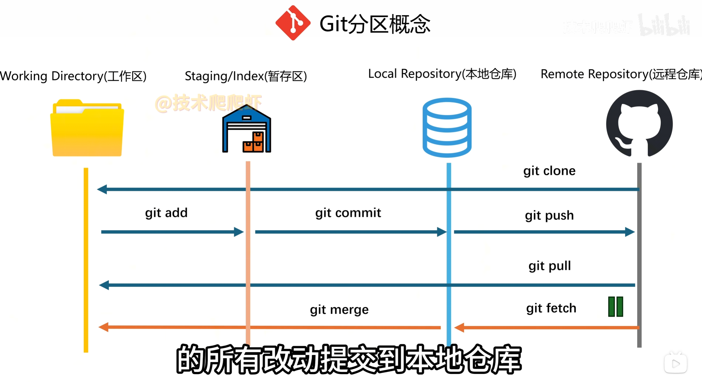

# git:
-  git init:将一个文件夹初始化为git仓库
-  commit id = commit hash,每次提交都有id
-  有三种更改提交的方式：
  1. 在保存文件且提交之前，通过discard删除本次修改；
  2. 给codex发送某次提交的commit hash,要求回到该次提交的形态，并删除后面的提交（reset）;
  3. 给codex发送某次提交的commit hash,要求撤销该次提交，并保持其他提交不变（生成反向commit,抵消某次commit）
- main/master是主干分支，可以再创建feature(1,2,3~)分支，分支代码的改变不会影响主干，分支也可以再创建，后期可将各分支和主干合并
## git分区概念
- working directory:工作区即本地文件夹；
- local reposotory:本地git仓库;
- remote reposotory:远程仓库，例如github

区分clone与pull:
clone用于第一次从github获取项目，保存在本地并创建本次仓库；
pull用于之后同步github上项目最新的更新情况
## 绑定远端仓库的方法：
- 在github上复制某个仓库的地址在vscode里打开，新建一个文件夹，即clone
- 先初始化一个本地仓库，将本地仓库的文件通过上传分支的方式，在vs里输入仓库名称
## github上好用的快捷键
- /可以直接打开搜索框
- t键可以直接打开项目中的文件搜索栏
- l键可以在文件代码页定位到具体行数
- ?可以打开快捷键速查表
## 多人协作：
现找到想去协作的项目，通过fork,复制一份到自己的仓库里，点code复制仓库地址，在vs打开，创建分支，进行自己的修改。如果此时母项目修改了，在codex里将母项目的最新代码合并到自己的分支，再上传至github，通过pull request，协作
## Cherry Pick:
拣选提交，对于分支三次提交创建了三个文件夹，只想提交某两个，复制两次提交id，让codex只把这两次提交合并到主干